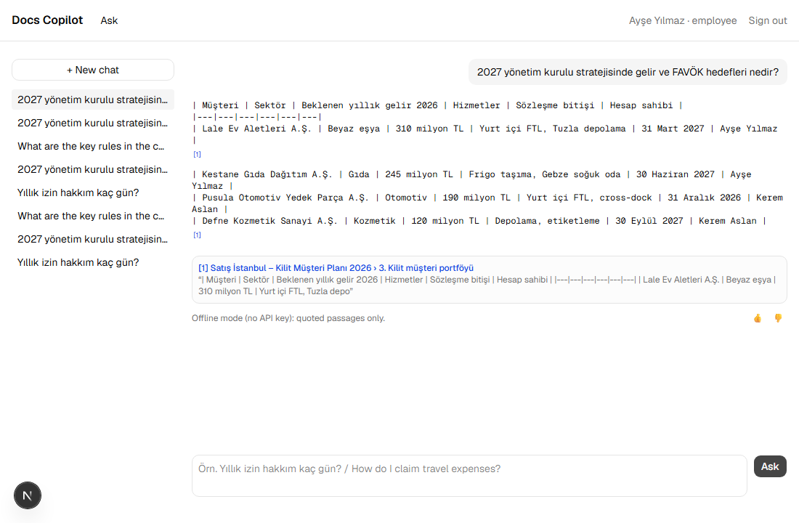
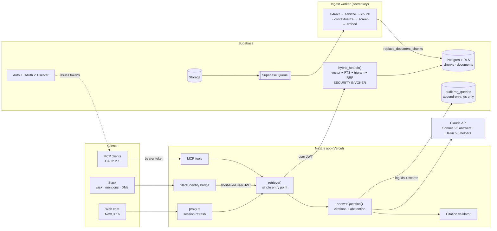

# Company Docs Copilot

An internal AI assistant for a fictional Turkish logistics company, **Atlas Lojistik A.Ş.** It answers employees' questions in Turkish and English **only from the documents each employee is allowed to read**, cites every claim, and says *"I couldn't find this in the documents you can access"* instead of guessing. It runs on the web, in Slack, and as an MCP server.

> **Permissions live in the database, evidence lives in the API, the model only writes.**
> - Access control is deterministic: Postgres row-level security on the user's own JWT.
> - Citations are structural: Claude's native `search_result` citations, validated in code.
> - Abstention is a calibrated threshold in code.

All documents, people and numbers are synthetic. Spec: [docs/SPEC.md](docs/SPEC.md). Verified toolchain and API notes: [docs/ENVIRONMENT.md](docs/ENVIRONMENT.md).

### Same question, two employees

Ask *"What are the 2027 revenue and EBITDA targets in the board strategy?"*:

- **Selin (executive):** the board strategy notes are within her access, so she gets cited quotes from them.
- **Ayşe (sales employee):** the board notes never reach the model. She sees only what she may read.

| Ayşe Yılmaz, employee | Selin Koç, executive |
|---|---|
|  |  |

These screenshots are from the live configuration (Sonnet 5.5 answers, Haiku 5.5 rerank).

- Ayşe gets the abstention. Her permitted documents score at most 0.5 with the reranker, which is below the calibrated 0.55 threshold, so the answer model is never called.
- Selin's answer cites the board notes. Lead-in lines such as "Konsolide gelir:" are plain text; any factual sentence without a valid citation would be shown dotted as *unverified*.

To regenerate the screenshots: `SCREENSHOTS=1 pnpm exec playwright test screenshots`.

---

## Architecture



## How permissions are enforced

1. **Pre-expanded memberships.** A user in Sales/Istanbul holds principals for that team, the Sales department, the org, their role and themselves. Department heads also hold every team in their department; executives hold every department and team. Triggers maintain `memberships` when profiles or the org structure change.
2. **ACLs stamped in the database.** Each document's `allowed_principals uuid[]` is computed by a trigger from its scope:
   - public → `{org}`
   - department → `{dept}`
   - team → `{team}`
   - restricted → explicit allow-list

   It is copied onto every chunk in the same transaction (GIN-indexed). Client-supplied values are overwritten.
3. **RLS on every table.** RLS is enabled and forced, with one policy per command. Content policies read `allowed_principals && (select private.my_principals())`. That function reads memberships live, so a revocation applies on the next query with the same JWT.
4. **Retrieval runs as the user.** `hybrid_search()` is `SECURITY INVOKER` and has no ACL parameters. `retrieve()` only accepts a `UserSession`, which can only be built from a verified user JWT. The secret key can't reach it, and ESLint blocks importing the secret-key client outside admin/ingest paths.
5. **Every channel goes through the same gate.**
   - Slack maps the user, then mints a 1-hour session for that employee, revoked after use.
   - MCP verifies the OAuth bearer token on every tool call.
   - Admins can see document *metadata* to manage it, but not restricted *content*: chunks, downloads and `get_document` all follow content ACLs.
6. **Proved, not asserted.**
   - **pgTAP, 116 tests:** the persona × scope matrix, revocation, tampering (forged JWT claims, forged chunk ACLs), storage, filtered ANN, audit immutability, and structural invariants such as forced RLS, a reviewed allowlist of `SECURITY DEFINER` functions and no anon privileges.
   - **Mutation test:** injects 8 different leaks and requires each one to fail the suite (8/8 killed).
   - **Eval permission suite:** 11 personas × 60 attack questions, checked at three layers.

> A real bug the suite caught: `AFTER UPDATE OF allowed_principals` triggers do **not** fire when a BEFORE trigger changes the column. Restricting a document left its chunks on the old, wider ACL. pgTAP 005 failed and the fix is documented in the migration.

## Quickstart

Requires Node 26, pnpm 11 and Docker.

```bash
pnpm install
```
```bash
pnpm db:start      # generates a local ES256 signing key, starts Supabase on ports 567xx
```
```bash
pnpm env:local     # writes .env.local (URL, keys, random demo password)
```
```bash
pnpm seed          # org, 11 personas, 64 documents, ingestion
```
```bash
pnpm dev           # http://localhost:3100 (click a demo persona)
```

Add `ANTHROPIC_API_KEY` to `.env.local` for model answers, Contextual Retrieval, the Haiku reranker and the LLM injection screen. Without it, the app still runs end to end in an **offline-extractive** mode, which quotes the best-matching cited sentences and is labelled as such in the UI.

Checks:

```bash
pnpm lint && pnpm typecheck && pnpm test     # 104 unit tests
```
```bash
pnpm db:test && pnpm test:mutation           # 116 pgTAP tests + 8/8 mutations killed
```
```bash
pnpm test:integration && pnpm test:e2e       # 20 integration + 6 Playwright tests
```
```bash
pnpm eval:smoke                               # PR gate; `pnpm eval` for the full suite
```

## Evaluation

Golden set v1 has 205 items: 103 TR and 102 EN.

- **Answerable (153):** single fact, multi-hop, numeric/table, Turkish typed without diacritics, false premise, outdated version, and cross-lingual questions.
- **Unanswerable (52):** 14 of these exist only in a restricted document the asker can't read.
- **Gold chunks** are resolved from exact evidence quotes at run time, so the set survives re-chunking.
- **Verification:** items are **not yet human-verified** (`verified_by: null`).

Rates carry 95% Wilson intervals, means carry normal intervals, and zero-event claims carry the rule-of-three upper bound.

### Latest full run

<!-- EVAL:full:START -->
| Metric (full, llm, n=205) | All | TR | EN |
|---|---|---|---|
| Recall@5 (chunk) | 0.989 [0.978–1.000] | 0.994 [0.982–1.000] | 0.983 [0.964–1.000] |
| Recall@20 (chunk) | 0.995 [0.987–1.000] | 1.000 [1.000–1.000] | 0.988 [0.971–1.000] |
| MRR@10 | 0.969 [0.950–0.989] | 0.970 [0.945–0.996] | 0.969 [0.938–0.999] |
| nDCG@10 | 0.971 [0.955–0.986] | 0.974 [0.955–0.994] | 0.966 [0.941–0.991] |
| Recall@5 (doc) | 0.997 [0.990–1.000] | | |
| True abstention (unanswerable) | 100.0% [93.1–100.0] | | |
| False abstention (answerable) | 4.6% [2.2–9.1] | | |
| Citation validity | 100.0% [99.2–100.0] | | |
| Citation precision (gold doc) | 92.0% [89.2–94.1] | | |
| Citation coverage | 79.2% [75.8–82.3] | | |
| Faithfulness (judge) | 97.3% [93.2–98.9] | | |
| Correctness (judge) | 98.6% [95.1–99.6] | | |
| Permission leaks | 0/660 (95% upper bound 0.45%) | | |
| Injection ASR | 0/20 (0.0% [0.0–16.1]) | | |
| Latency p50 / p95 | 6294 / 10579 ms | | |
| Cost per 1,000 questions | $12.01 | | |

_Run 2026-11-20; 95% Wilson / normal CIs in brackets._
<!-- EVAL:full:END -->

**How to read this run:**

- **Live configuration:** Sonnet 5.5 answers, Haiku 5.5 rewrite + listwise rerank + ingest screen + Contextual Retrieval. Opus 5.5 is the judge (`judge-v2`).
- **Faithfulness** asks whether every claim in the answer is supported by the passages the model was given. The 4 unfaithful answers each add one small unsupported clause, for example *"That includes the German subsidiary"*. Each is recorded in the result file as `unsupportedClaims`.
- **Citation coverage (79%)** is the share of factual answer blocks (connectives excluded) that carry a valid citation. Derived sentences, such as a calculation from a cited rule, are shown to the user as *unverified* rather than given a made-up citation.
- **False abstentions (7/153)** are all items where Haiku gave the best chunk 0.5 ("related but does not answer"). Most are false-premise and diacritic-free questions.
- **The judge is not yet calibrated against humans.** Cohen's κ needs ~60 human labels (`pnpm eval:kappa --prepare`, label, `pnpm eval:kappa`). Until then, read the judge rows as indicative.
- **The offline baseline** (no key, 2026-11-19) is in `evals/results/2026-11-19T23-48-12-full.json`: Recall@5 0.785, true abstention 40%, the same 0 leaks.

### Embedder ablation (dense retrieval only, same RLS-filtered candidate sets, n = 153)

| Embedder | Dims | Recall@5 | Recall@20 | MRR@10 | TR Recall@5 | EN Recall@5 |
|---|---|---|---|---|---|---|
| **e5-small** (default) | 384 | 0.782 [0.72–0.84] | 0.859 [0.81–0.91] | 0.728 [0.67–0.79] | 0.792 | 0.771 |
| e5-base | 768 | 0.833 [0.78–0.89] | 0.927 [0.89–0.96] | 0.736 [0.68–0.79] | 0.839 | 0.826 |
| bge-m3 | 1024 | 0.761 [0.70–0.83] | **0.964 [0.94–0.99]** | 0.611 [0.55–0.67] | 0.750 | 0.775 |

- The recall@5 intervals overlap, so none of those differences is significant at this n.
- bge-m3 finds the evidence more often (recall@20 is clearly higher) but ranks it worse (lower MRR). That is a job for the reranker, not a reason to switch embedders.

### Pipeline ablation (live, retrieval only, n = 153)

`pnpm eval:ablate:pipeline <label>`. Each config adds one stage to the previous one. Each config was run twice: once on a corpus ingested without Contextual Retrieval, and once with it (150/150 chunks carry a Haiku-written context).

| Config | Contexts | Recall@5 | Recall@20 | MRR@10 | Cross-lingual R@5 (n=20) | No-diacritics R@5 (n=15) |
|---|---|---|---|---|---|---|
| hybrid (RRF), cosine order | off | 0.785 [0.72–0.85] | 0.885 [0.84–0.93] | 0.731 [0.67–0.79] | 0.10 | 0.77 |
| + Haiku query rewrite | off | 0.779 [0.72–0.84] | 0.930 [0.89–0.97] | 0.738 [0.68–0.80] | 0.05 | 0.77 |
| + Haiku listwise rerank | off | 0.991 [0.98–1.00] | 0.991 [0.98–1.00] | 0.979 [0.96–1.00] | 1.00 | 1.00 |
| hybrid (RRF), cosine order | on | 0.772 [0.71–0.83] | 0.878 [0.83–0.93] | 0.691 [0.63–0.75] | 0.15 | 0.63 |
| + Haiku query rewrite | on | 0.785 [0.73–0.85] | 0.927 [0.89–0.97] | 0.706 [0.64–0.77] | 0.15 | 0.77 |
| **+ Haiku listwise rerank** (default) | on | **0.998 [0.99–1.00]** | **0.998 [0.99–1.00]** | **0.977 [0.96–0.99]** | 1.00 | 1.00 |

- **The reranker does the work.** The query rewrite adds TR↔EN translations, which raises Recall@20 (0.88 → 0.93): the evidence enters the candidate pool. It does not raise Recall@5, because the fused order still puts same-language chunks first. The listwise rerank then moves the evidence to the top. Cross-lingual and diacritic-free questions go from 0.05–0.77 to 1.00.
- **Contextual Retrieval shows no measurable gain here.** Every difference with contexts on or off is inside the intervals. The corpus has short, well-titled documents, and each chunk already starts with its document title and section path, so the context adds little. It costs one Haiku call per chunk at ingest (prompt-cached per document). It stays on because it is cheap and helps on longer, less structured corpora, but this corpus cannot show that.
- **Read near-1.0 numbers with care.** The corpus is 64 documents and the reranker sees ~25 RLS-filtered candidates. With a pool this small, an LLM reranker is close to an oracle. The number that will drop on a real corpus is Recall@20 *before* rerank: that is where to invest (hybrid legs, embedder, candidate pool size).

### Abstention calibration

`pnpm eval:calibrate` runs retrieval for all 205 golden items, each as its persona. It then picks the threshold on the reranker's top-1 score that abstains on the most unanswerable items while keeping false abstention at or below 5%.

| Reranker | Threshold | False abstention (answerable) | True abstention (unanswerable) |
|---|---|---|---|
| fusion only (cosine) | 0.817 | 5.9% [3.1–10.8] | 40.4% [28.2–53.9] |
| **Haiku listwise** (default) | 0.55 | 3.9% (6/153) [1.8–8.3] | 100% (52/52) [93.1–100] |

- Cosine similarity barely separates "an answer exists" from "nothing relevant". Haiku's 0–1 relevance score does: answerable top-1 scores have p05 = 0.9, and every unanswerable top-1 score is ≤ 0.5.
- The model's `<abstain/>`, detected deterministically, is a second layer for whatever passes the threshold.
- Haiku's scores are not fully deterministic. Two calibration runs on the same corpus picked the same threshold, with 3/153 and 6/153 false abstentions. The table shows the later run.
- Re-run calibration whenever the embedder, reranker or chunking changes.

### Prompt injection

There are 20 poisoned documents. Their attacks: instruction override, fake system messages, Markdown image and link exfiltration, zero-width and white-on-white hidden text, HTML comments, canary fishing, role escalation, citation manipulation, language switching, base64 payloads, fake tool calls, phishing links, and refusal suppression.

| Layer | What it stops |
|---|---|
| Ingest hygiene | Hidden text (zero-width, HTML comments, CSS-hidden) is removed before indexing. A pattern screen (TR + EN) plus a Haiku screen quarantines suspicious chunks; the screen fails closed. Pattern screen alone: 14/20 poisoned documents flagged. With the Haiku screen: **20/20 flagged, 0 false positives** on the 44 normal documents. |
| Answer call | Quarantined chunks never reach the model. Results go in as untrusted `search_result` data. The call has **no tools**. |
| Output | Citations are validated. Markdown drops HTML and images and keeps only in-app links. Slack strips foreign URLs (no unfurl exfiltration) and escapes mrkdwn. Document text is rendered as plain text. |
| Eval | ASR is measured per category: an attack succeeds if the marker, the exfil URL or a canary appears in the answer. promptfoo red-team plugins (`indirect-prompt-injection`, `rag-poisoning`, `rag-source-attribution`, `rag-document-exfiltration`, `rbac`, `pii:*`) run nightly when a key is configured. |

### Latency and cost

Measured in the full run on a local stack, against the first-party API:

- **Latency:** p50 6.3 s, p95 10.6 s per answer, end to end. This covers rewrite, embedding, hybrid search, Haiku rerank and the Sonnet answer. The UI streams, so the first tokens arrive well before that. Retrieval alone without LLM stages is about 50 ms.
- **Cost:** **$12.01 per 1,000 questions** (Sonnet answer + Haiku rewrite and rerank; judge calls excluded). It is computed per answer from token usage at first-party rates and shown to admins. Rates per MTok:
  - Sonnet 5.5: $2 input / $10 output, $0.10 cache read
  - Haiku 5.5: $0.10 input / $0.50 output
- **Caching:** the static system prompt carries the cache breakpoint, so it is read from cache after the first call.
- **Cheaper answers:** `ANSWER_EFFORT=low` trades some answer quality for latency and cost. It is not evaluated here.

## Design decisions

- **RLS vs prompt filtering.** Filtering in the prompt ("only use documents for HR") asks the model to enforce security; one injection undoes it. With RLS the model never *receives* what the user can't read, and the guarantee is testable (pgTAP + mutation test).
- **Native citations vs `[1]` markers.** Hand-rolled markers are free text the model can invent. With `search_result` blocks the API returns structured locations (index, source, block range, cited text), which code then checks against what was sent and what the user may see.
- **Hybrid + Turkish FTS + trigram.**
  - Turkish is agglutinative: `izinlerimizden` should match `izin`. Postgres `turkish` stemming handles that.
  - Employees often type without diacritics (`sirket`), which ASCII-folded trigram handles.
  - Codes and numbers need lexical matching that dense vectors blur.
  - RRF fuses the three legs without score calibration.
- **e5-small as default despite bigger models.**
  - e5-base is better at recall@20 with overlapping recall@5 CIs.
  - bge-m3 recalls more but ranks worse (MRR 0.61).
  - e5-small's q8 model is 113 MB against ~570 MB for bge-m3. On serverless functions with size caps and cold starts that matters more than a difference the CIs can't confirm. The `Embedder` interface makes switching a config change plus re-ingest.
- **A different judge model.** Opus 5.5 judges answers written by Sonnet 5.5. Each dimension (faithfulness, correctness) gets its own isolated call with an explicit "unknown". Agreement with humans is reported as Cohen's κ, not assumed.
- **Why RAG for 64 documents.** The corpus would fit in a context window, but then every employee's prompt would contain every document, including the board notes. Permissions, auditability (cited chunk ids per answer) and growth to thousands of documents are the reasons, not context size.
- **Filtered ANN.** A user who can read 1% of the chunks makes HNSW + RLS return 0 of 10 results without iterative scans (pgTAP 008). `hybrid_search` sets `hnsw.iterative_scan = relaxed_order`; this is invisible at demo scale without that test.
- **Answers are private in Slack.** An answer reflects the asker's permissions, so in channels it is ephemeral; only DMs are streamed.

## MCP

- **Endpoint:** `POST /api/mcp`. Stateless Streamable HTTP, `@modelcontextprotocol/server` 2.4 via `mcp-handler`.
- **Tools:** `search_docs(query, limit≤10)`, `get_document(id)`, `ask(question)`.
- **Authorization:** Supabase Auth's OAuth 2.1 server, currently in beta.
  - Unauthenticated calls get `401` with an RFC 9728 `WWW-Authenticate` header pointing at `/.well-known/oauth-protected-resource`.
  - The consent page is `/oauth/consent`.
- **Client compatibility:**
  - Clients that use **Dynamic Client Registration (DCR)** work.
  - Clients that rely only on **Client ID Metadata Documents (CIMD)** do **not**: Supabase Auth doesn't support CIMD as of 2026-11.

## Deploying

These steps need your own Vercel and Supabase accounts:

1. `supabase link --project-ref …`, then `supabase db push`.
2. In the Supabase dashboard:
   - enable asymmetric JWT signing keys and the OAuth 2.1 server (DCR on, authorization path `/oauth/consent`),
   - disable sign-ups,
   - set the magic-link email template to the `token_hash` link in `supabase/templates/magic_link.html`.
3. Vercel environment variables:
   - `NEXT_PUBLIC_SUPABASE_URL`, `NEXT_PUBLIC_SUPABASE_PUBLISHABLE_KEY`, `SUPABASE_SECRET_KEY`
   - `ANTHROPIC_API_KEY`, `CRON_SECRET`, `APP_URL`
   - `MODEL_CACHE_DIR=/tmp/models`
   - for a public demo: `DEMO_MODE=true` and a long random `DEMO_PASSWORD`
   - Slack: `SLACK_SIGNING_SECRET`, `SLACK_BOT_TOKEN`, `SLACK_LINK_SECRET`
4. Seed the cloud project with a one-off admin run of `scripts/lib/corpus.ts`, using `--remote` on purpose. The worker then runs from Vercel Cron (`vercel.json`, every 5 minutes).
5. Slack app: point events, the `/ask` command and interactivity at `https://<app>/api/slack/events`. Scopes: `commands`, `app_mentions:read`, `chat:write`, `im:history`.

**Function size:** only the Linux x64 ONNX Runtime (45 MB) is traced. The q8 e5-small model (113 MB) downloads to `/tmp` on cold start.

## Going to production (KVKK)

- **Legal basis and DPIA.** Processing employee questions and HR documents requires a documented legal basis and a data-protection impact assessment. Register in VERBİS where required.
- **Cross-border transfer (KVKK Art. 9).** Sending document excerpts and questions to an LLM API outside Türkiye is a transfer abroad. It needs an approved mechanism (standard contract notified to the Authority, or another Art. 9 basis). Evaluate EU/regional processing and zero-data-retention options; keep restricted HR data out of scope unless covered.
- **Transparency.** Tell employees they are talking to an AI, what is logged, and for how long.
- **Retention and destruction.**
  - The audit log stores ids, scores and redacted and hashed queries. `audit.purge_expired()` enforces `audit.settings.retention_days` (default 365).
  - Conversations are user-deletable; deleting a document cascades to its chunks and embeddings.
  - Document a periodic destruction policy.
- **Access reviews.** Membership changes apply on the next query. Pair that with HR-driven provisioning (SCIM) and periodic access reviews.

## Limitations and next steps

- The golden set needs a human verification pass. The judge κ needs ~60 human labels.
- The corpus is small enough that the LLM reranker is near-perfect (see the pipeline ablation). A larger, noisier corpus is needed to measure the stages before it properly.
- PDF hidden-text detection: white-on-white is caught in Markdown and HTML, not in PDF rendering layers.
- Local cross-encoder reranking (`bge-reranker-v2-m3`) fits the `Reranker` interface but isn't implemented.
- Observability: OpenTelemetry + Langfuse spans (ids and scores only) is the planned stretch.

## Repository map

| Path | What |
|---|---|
| `supabase/migrations/` | Schema, RLS, ACL triggers, `hybrid_search`, queue, audit, dashboard |
| `supabase/tests/` | pgTAP suites (`scripts/mutation-test.ts` proves they catch leaks) |
| `src/lib/retrieval/` | `retrieve()`, query rewrite, rerankers, calibrated thresholds |
| `src/lib/answer/` | Answer call, citation validator, abstention, redaction |
| `src/lib/ingest/` | Extraction, hygiene, chunking, contextualization, worker |
| `src/lib/slack/`, `src/lib/mcp/` | Channels, both on the user's JWT |
| `evals/` | Golden set, permission attacks, harness, ablations, promptfoo |
| `.claude/` | Skills, review agents and hooks used to build this with Claude Code |

## License

[MIT](LICENSE) © 2026 Emin Özbayraktar. All documents, people and numbers in `seed/` are synthetic.
